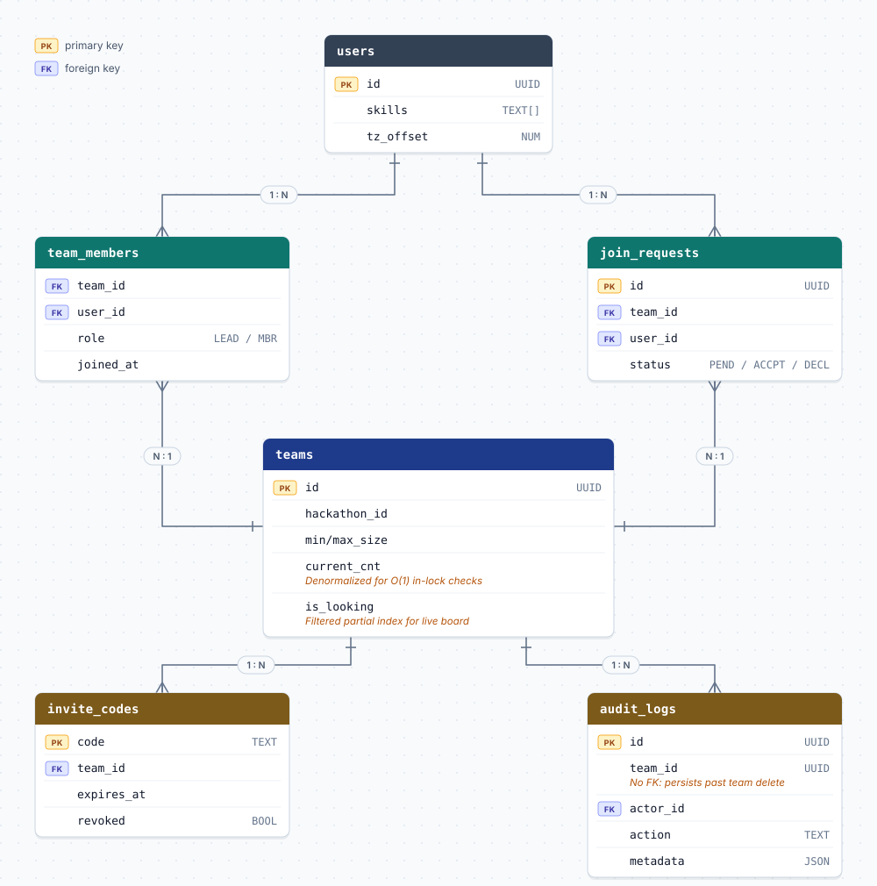

# System Design Document: Saathi — Race-Proof Hackathon Team Formation

> **Problem Statement (PS1):** Saathi is a resilient, production-grade team-formation service for a 10,000-participant hackathon. When 50 people click "join" at the exact same millisecond for the last remaining seat, exactly one succeeds and 49 receive clean 409 Conflict errors—with zero corruptions, full idempotency, and live updates.

---

## 1. Relational Data Model

The schema is normalized for transactional integrity while maintaining strategic denormalizations for high-throughput reads:



### Invariants Enforced at Schema Level
- **One Team Per User Per Hackathon:** `CONSTRAINT one_team_per_user_per_hackathon UNIQUE (hackathon_id, user_id)` on `team_members`.
- **Bounds Checking:** Check constraints enforce `min_size >= 1`, `max_size >= min_size`, and `current_member_count <= max_size`.
- **Immutable Audit Trail:** Append-only logs without cascading deletes to guarantee auditability even after team deletion.

---

## 2. Preventing Race Conditions & Ensuring Idempotency

### The TOCTOU Challenge
In high-concurrency spikes, naïve read-then-write logic (`SELECT count(*) -> IF count < max -> INSERT`) fails due to Time-of-Check to Time-of-Use race windows, permitting oversold teams.

### Row-Level Locking (`SELECT ... FOR UPDATE`)
Every mutating team operation runs inside a single atomic transaction:
```sql
BEGIN;
-- 1. Acquire exclusive lock on the target team row
SELECT * FROM teams WHERE id = $1 FOR UPDATE;

-- 2. Validate seat availability under exclusive lock
IF current_member_count >= max_size THEN
    ROLLBACK;
    RETURN 409 'TEAM_FULL';
END IF;

-- 3. Atomically mutate membership and team state
INSERT INTO team_members (team_id, hackathon_id, user_id, role) VALUES ($1, $2, $3, 'MEMBER');
UPDATE teams SET current_member_count = current_member_count + 1 WHERE id = $1;
INSERT INTO audit_logs (team_id, hackathon_id, actor_id, action, metadata) VALUES (...);

COMMIT;
```

**Why Pessimistic Locking over Optimistic Concurrency Control (OCC):**  
Under OCC (e.g., `WHERE version = v`), 50 concurrent transactions produce 1 commit and 49 serialization failures requiring retry loops, causing massive CPU churn and latency spikes. With `SELECT ... FOR UPDATE`, transactions queue deterministically on the database row. The winner commits; the remaining 49 immediately see `current_member_count == max_size` and fail fast with `409 TEAM_FULL` in single-digit milliseconds.

### Distributed Request Idempotency
Flaky networks and rapid double-clicks are handled through transactional idempotency:
1. Every mutating request accepts an optional `Idempotency-Key` header.
2. Inside the transaction, an advisory lock `pg_advisory_xact_lock(hashtext(userId || ':' || idempotencyKey))` serializes duplicate concurrent submissions.
3. If the key exists in `idempotency_keys`, the previous status code and response payload are immediately returned with `replayed: true`, executing the mutation exactly once.

---

## 3. Key Architectural Trade-Offs

| Decision | Chosen Approach | Alternative Considered | Rationale |
| :--- | :--- | :--- | :--- |
| **Member Count Tracking** | **Denormalized `current_member_count`** on `teams` table | Dynamic `SELECT COUNT(*)` on `team_members` | Scanning `team_members` requires secondary aggregate calculations and table-level locks. Denormalizing the count allows an instantaneous $O(1)$ check directly on the locked team row. Guarded by a Postgres `CHECK (current_member_count <= max_size)` constraint to prevent drift. |
| **Real-Time Delivery** | **Server-Sent Events (SSE)** via HTTP/2 (`GET /api/events`) | Full-Duplex WebSockets (`ws://`) | SSE operates over standard HTTP, natively supports auto-reconnection and event IDs, transverses enterprise proxies/CDNs cleanly, and requires no connection upgrade handshakes. Since client mutations are idempotent REST requests with headers (`x-user-id`, `Idempotency-Key`), unidirectional server push is simpler, lighter, and more reliable. |
| **Live Board Acceleration** | **In-Memory Micro-Cache** (2s TTL + instant invalidation on mutation) | Uncached direct DB query on every request | In a 100-connection Autocannon stress test, uncached queries to remote DB exhausted connection pools (p95 ~1.7s). Micro-caching reduced p95 latency to **2 ms** (12,131 req/sec) while mutation-driven invalidation guarantees zero stale data. |
| **Brute-Force Protection** | **In-Memory Sliding-Window Limiter** (5 attempts / 30s per IP+User) + 96-bit codes | Redis token bucket | 16-character base64url codes ($2^{96}$ entropy) make brute-forcing mathematically infeasible. The in-memory sliding window provides immediate local protection with zero network overhead. |

---

## 4. What We Would Build With One More Week

1. **Multi-Node Redis Cluster Pub/Sub & Rate Limiting:**  
   Replace the single-node in-memory SSE bus and sliding-window limiter with Redis Streams and Redis Token Buckets (`ioredis`), allowing horizontal scaling of the API tier across multiple container instances.
2. **PostgreSQL Read Replicas & Connection Pooling:**  
   Introduce PgBouncer in transaction mode alongside read replicas for `GET /api/board` and `GET /api/suggestions`, reserving primary database connections strictly for write transactions with `FOR UPDATE` locks.
3. **Semantic Teammate Recommendations via pgvector:**  
   Upgrade the linear 65% skill overlap + 35% timezone score algorithm to cosine similarity vector search using OpenAI/Gemini embeddings stored in `pgvector`, discovering complementary skills beyond exact string keyword matches.
4. **Automated Deadlock Detection & Backoff:**  
   Add jittered exponential backoff retries for transient transaction deadlocks (`40P01`) under cross-table multi-resource operations.

